# System Architecture

This document describes the high-level architecture of the Obsidian Local AI Agent.

## Overview

The system is designed as a local Python application that acts as an intermediary between the user, the Obsidian Vault (filesystem), and the local LLM inference engine (Ollama).

```mermaid
graph TD
    User([User]) <--> UI[Web UI / CLI]
    UI <--> Agent[Python RAG Agent]
    
    subgraph Local Inference
        Agent <--> Ollama[Ollama Server]
        Ollama <--> LLM[qwen3-vl:2b-instruct]
        Ollama <--> Embed[nomic-embed-text]
    end
    
    subgraph Data Layer
        Agent -->|Embed Notes| DB[(ChromaDB)]
        DB -->|Retrieve Context| Agent
        Agent -->|Read/Write| Vault[(Obsidian Vault .md)]
    end
    
    subgraph Safety System
        Agent -->|Pre-write Backup| Git[Git Version Control]
        Agent -.->|Request Permission| User
    end
```

## Core Components

1.  **Obsidian Vault (Data Source):** Your personal Markdown files. The system will watch this directory for changes or ingest it periodically.
2.  **Ollama Engine:** Runs locally on port `11434`. It handles both generating text/analyzing images (`qwen-vl`) and generating vector embeddings (`nomic-embed-text`).
3.  **ChromaDB:** A local vector database that stores the mathematical representations of your notes. This allows for fast semantic search (finding notes about a specific topic even if the exact keyword isn't used).
4.  **Agent Logic (native Python):** The "brain" that connects retrieval, Ollama chat, image analysis, and permission-gated vault tools. It has a bounded local clock tool for exact time/date questions; it does not execute arbitrary model-provided commands.
5.  **Git Backup System:** The safety net. Any write operations triggered by the agent will be preceded by a git commit on the vault, allowing the user to `git revert` if the AI makes a mistake.

## Workflow: Answering a Question

1.  **User Input:** User asks a question (e.g., "What did I learn about Python yesterday?").
2.  **Embedding:** The question is converted into a vector using `nomic-embed-text`.
3.  **Retrieval:** The vector is matched against ChromaDB to find the most relevant notes from the Obsidian vault.
4.  **Prompt Construction:** The retrieved notes are bundled with the user's question into a prompt.
5.  **Generation:** `qwen3-vl:2b-instruct` processes the prompt and generates a response.
6.  **Output:** The response is shown to the user.

## Time-sensitive questions

The configured `TIMEZONE` (an IANA name such as `Asia/Baku`) is the source of truth for “today”, “yesterday”, and direct clock questions. The RAG prompt includes a current timestamp so a model has temporal context, while exact questions such as “İndi saat neçədir?” bypass the model and use the safe local clock tool.
